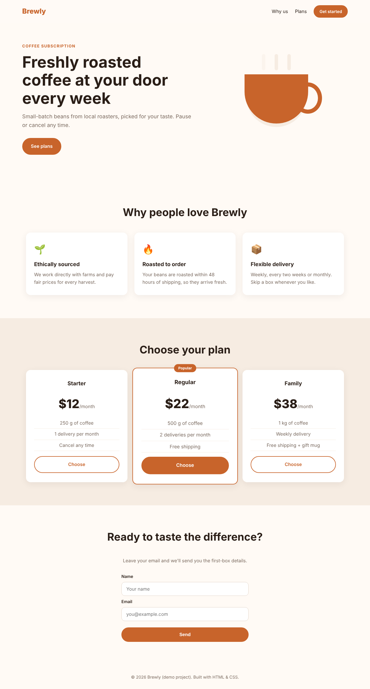

# Landing Page (HTML & CSS)

A responsive one-page website for a fictional coffee subscription ("Brewly"). Demo project, no real brand.

## Features
- Clean modern design, mobile-first responsive layout (tested at 390 px and 1280 px)
- Sections: hero, features, pricing, contact form
- Pure HTML and CSS: CSS variables, Grid, Flexbox, a CSS-drawn animated cup, no frameworks

## Run it
Just open `index.html` in a browser.
